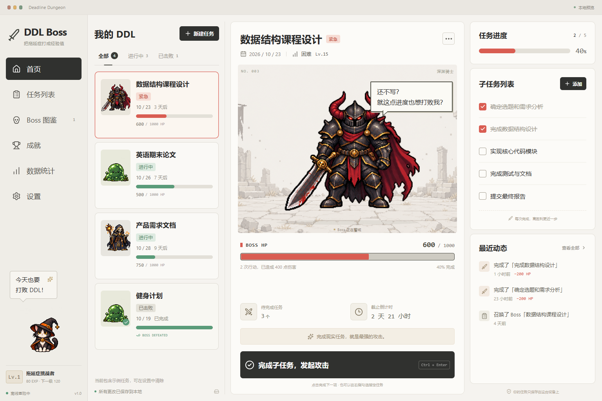

# DDL Boss 战 · Deadline Dungeon

以前是 DDL 追着我跑，现在是我追着 DDL 打。

将现实截止任务变成像素 Boss 的 Windows 桌面应用。界面参考提供的米白四栏设计图，规则以 PRD v1.0 为准。核心功能离线运行，不使用账号、服务器或大模型 API。



## 直接运行

[下载 Windows x64 安装包](https://github.com/Fantasy0504/DDL-Boss/releases/download/v1.0.0/Deadline-Dungeon-1.0.0-Setup.exe) · [查看版本说明](https://github.com/Fantasy0504/DDL-Boss/releases/tag/v1.0.0) · [SHA-256 校验文件](https://github.com/Fantasy0504/DDL-Boss/releases/download/v1.0.0/SHA256SUMS.txt)

下载后双击安装包，选择安装目录即可使用，无需安装 Node.js 或其他开发环境。首次启动含可清除的示例任务。

本地构建产物在 `release/Deadline-Dungeon-1.0.0-Setup.exe`。安装包通过 GitHub Release 分发，不放入 Git 源码历史。

已解包的程序在 `release/win-unpacked/DDL Boss.exe`。分发该版本时需要保留整个 `win-unpacked` 文件夹。

首次启动含四个可编辑的示例任务。设置 → 清除示例可移除示例及其战绩，不影响自己创建的任务。

## 开发与构建

推荐 Node.js 24，最低版本 22.12，Windows 10/11 x64。

```powershell
npm ci
npm run dev:desktop
```

只预览界面：

```powershell
npm run dev
# http://127.0.0.1:5173
```

浏览器预览使用浏览器本地存储；桌面应用使用 Electron 主进程管理 JSON，两者的数据互相独立。悬浮窗、系统托盘和开机自启动需要桌面版；开机自启动仅在打包安装版中设置。

```powershell
npm run build           # TypeScript 检查 + Vite + Electron 主进程/preload 编译
npm start               # 运行已构建桌面应用
npm test                # 领域规则与文件存储测试
npm run dist            # 生成 Windows NSIS 安装包
npm run dist:portable   # 生成 Windows 便携单文件程序
```

首次运行/打包可能需要下载 Electron 与 NSIS 构建工具。如果已安装本地 Electron 二进制，可复用：

```powershell
npx electron-builder --win nsis --x64 --config.electronDist=node_modules/electron/dist
```

## 使用流程

1. 新建任务：快速模式只填名称和截止时间；完整模式可设置难度、Boss 外观、子任务、权重及备注。
2. 选择 DDL：左侧按截止时间排序，筛选进行中、已击败；任务列表页另支持逾期筛选、搜索及排序。
3. 完成子任务：勾选右侧清单，或按 `Ctrl + Enter` 完成下一项，Boss 立即扣血、闪烁并显示伤害。
4. 击败 Boss：全部子任务完成后结算经验并收入图鉴；提前超过 24 小时完成额外奖励 30 EXP。
5. 撤销或编辑：已结算任务会先提示，重新完成不重复发放经验。删除默认保留图鉴，可选择一并删除。
6. 桌面陪伴：自动显示最早截止的未完成 DDL。单击打开任务，拖动移动，悬停查看倒计时与 HP，右键打开菜单。
7. 关闭与退出：默认关闭主窗口后驻留托盘；从托盘右键菜单选择退出，可结束所有窗口和后台进程。
8. 演示模式：设置 → 进入演示模式，顶部可切换警戒、狂暴与逾期时间。所有演示修改均在独立内存数据中，退出即恢复真实记录。

## 已实现

- 任务快速/完整创建、编辑、删除、加权子任务、撤销、截止筛选和搜索。
- 三种原创像素 Boss：森林史莱姆、骷髅法师、深渊骑士，以及休息状态巫师猫。
- 统一 1000 HP，血量根据子任务实时计算；进度按权重计算，完成数量另行显示。
- 待机、警戒、狂暴、低血量台词、受击、击败、逾期状态和可选短音效。
- 首次结算、提前奖励、极限反杀称号、Boss 图鉴、基础成就和行动统计。
- 透明悬浮窗、透明像素点击穿透、拖动、缩放、置顶、隐藏/恢复、多屏边界约束。
- 主窗口/悬浮窗 IPC 联动、托盘驻留、设置持久化、安装版开机自启动。
- 主进程 JSON 原子写入、最近有效备份、损坏恢复、导入/导出、数据校验。
- 独立演示模式和适配较窄浏览器预览的响应式布局。

## 规则与数据

存储位置为 Electron `app.getPath('userData')` 下的 `dungeon.json`。默认 Windows 路径为 `%APPDATA%/deadline-dungeon/dungeon.json`；应用名称或系统配置可改变目录。

每次写入先生成临时文件并 `fsync`，再保留上一份有效文件为 `dungeon.json.bak`，最后重命名替换。主文件损坏时尝试恢复备份，同时保留带时间戳的损坏原件。若都无法读取则停止加载并显示错误，不自动覆盖用户数据。

HP = round(1000 × (1 − 已完成权重 / 总权重))。极端权重分布下，未全部完成时至少保留 1 HP，避免四舍五入造成提前击败。任何子任务全部完成才进入胜利状态。

奖励记录保存首次击败时的难度、时间与经验；外观变更不影响进度。手动删除图鉴记录会同时从图鉴累计经验中移除该记录对应的经验。统计中的行动次数来自最近保留的 500 条活动，含撤销后重新完成的行动。

Renderer 无 Node.js / 文件系统访问权限，启用 `contextIsolation` 和沙箱。preload 仅暴露限定 API，IPC 校验来源窗口和输入结构，禁止任意导航及创建外部窗口。实现依据 [Electron BrowserWindow 文档](https://www.electronjs.org/docs/latest/api/browser-window)与[自定义窗口交互说明](https://www.electronjs.org/docs/latest/tutorial/custom-window-interactions)。

## 项目结构

```text
electron/       主进程、受限 preload、串行 JSON 存储
shared/         数据模型、Zod 校验、HP/状态/结算、纯事务函数
src/            React 界面、Zustand 状态、Boss 与悬浮窗组件
public/assets/  原创透明角色图集、背景、应用图标
scripts/        构建、桌面开发、浏览器与 Electron 自动验证
tests/          领域规则与持久化测试
docs/           设计规范、素材记录、验证记录、演示脚本
release/        Windows 安装程序与解包应用（构建产物）
```

## 自动验证

```powershell
npm test
# 需先启动 npm run dev
$env:CHROME_PATH = 'C:\Program Files\Google\Chrome\Application\chrome.exe'
node scripts/verify-ui.mjs
# 需先 npm run build
node scripts/verify-desktop.mjs
# 安装包的实际应用二进制验证（需先打包）
node scripts/verify-desktop.mjs --packaged
```

浏览器验证默认使用 Playwright Chromium；设置 `CHROME_PATH` 可复用本机 Chrome。截图默认保存在系统临时目录 `ddl-boss-qa`，不会混入源代码。桌面测试使用独立临时 userData，关闭后清理，不改动真实数据。

验证证据与仍需人工检查的项目见 [QA 记录](docs/qa.md)。参考图对照与设计取舍见 [设计规范](docs/design.md)。图像生成方式及素材提示词见 [素材记录](docs/assets.md)。

## 交付边界

本项目已实现可运行的 MVP，源码与安装包通过本仓库和 GitHub Releases 分发。安装包目前未做代码签名；开机登录、多显示器实际热插拔，以及全新 Windows 虚拟机安装仍需在目标环境人工验收。实际 Kiro 开发过程记录和正式参赛视频尚未提供。提供 [60–90 秒演示脚本](docs/demo-script.md) 供录制使用。
